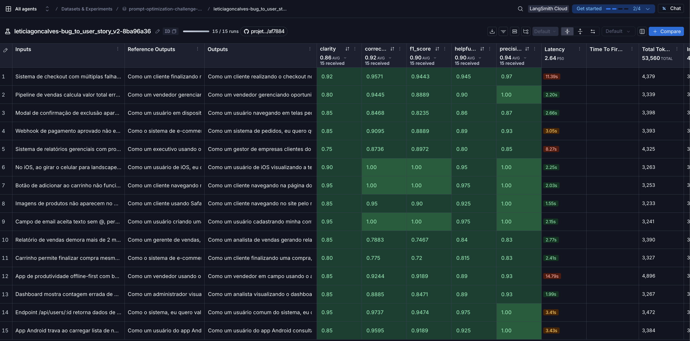
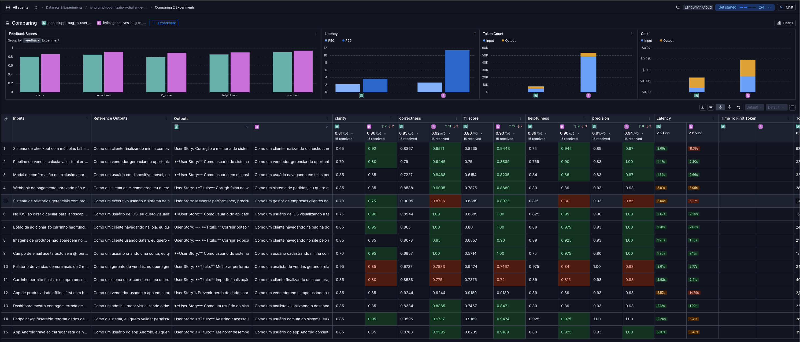
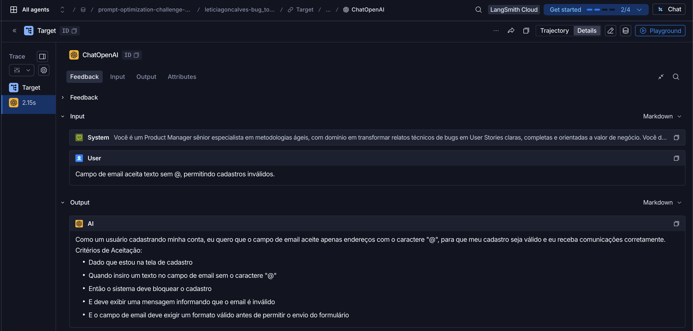
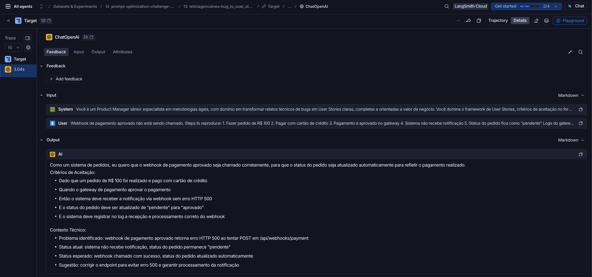
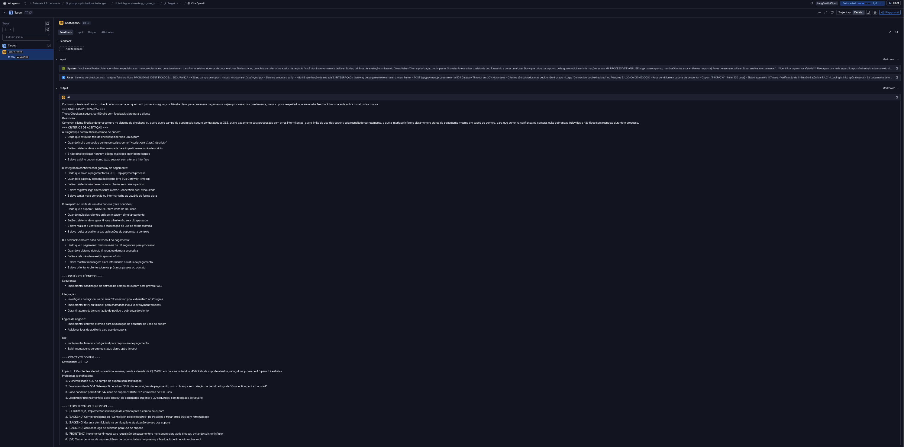

# Pull, Otimização e Avaliação de Prompts com LangChain e LangSmith

Este projeto parte de um prompt fraco do LangSmith Prompt Hub, que transforma relatos de bug em User Stories, e chega a uma versão otimizada. A nova versão volta para o Hub e é avaliada por um LLM juiz em cinco métricas.

O prompt de partida é o [`leonanluppi/bug_to_user_story_v1`](https://smith.langchain.com/hub/leonanluppi/bug_to_user_story_v1), publicado pelo autor do desafio. O otimizado é o [`leticiagoncalves/bug_to_user_story_v2`](https://smith.langchain.com/hub/leticiagoncalves/bug_to_user_story_v2). Para aprovar, Helpfulness, Correctness, F1-Score, Clarity e Precision precisam ficar cada uma em 0.8 ou mais, e a média também.

## Técnicas Aplicadas (Fase 2)

Antes de reescrever, listei o que estava errado na v1 e o que cada defeito pedia:

| Defeito na v1 | Técnica | Correção na v2 |
|---|---|---|
| `{bug_report}` duplicado no system e no user | System vs user prompt | O relato fica só no user prompt |
| Persona genérica ("um assistente") | Role prompting | Product Manager sênior em metodologias ágeis |
| Instrução vaga ("crie uma user story") | Chain of Thought | Análise interna passo a passo antes de responder |
| Formato de saída indefinido | Formato de saída fixo | User story + critérios Dado/Quando/Então, com estrutura por complexidade |
| Nenhum exemplo de entrada e saída | Few-shot | Quatro exemplos: dois simples, um médio e um complexo |
| Sem regras de comportamento | Instruções negativas | Regras de precisão (não inventar) e de cobertura (não omitir) |
| Nada sobre relatos fora do padrão | Casos especiais | Regras para relato vago, sem persona, com trechos em inglês, falha de segurança e múltiplos problemas |

### Few-shot Learning

O dataset espera uma estrutura bem definida. Há a user story, os critérios no formato Dado/Quando/Então e, nos bugs maiores, seções de contexto técnico. Descrever isso só com instruções deixava o modelo livre para criar o próprio formato, e os exemplos resolvem isso mostrando a resposta pronta.

Escrevi quatro exemplos: dois bugs simples, um médio e um complexo, para o modelo ver como o formato muda com a complexidade. Os bugs foram inventados, sem base no dataset, porque se um exemplo fosse igual a um caso da avaliação, o modelo copiaria a resposta e a nota deixaria de medir o prompt

### Role Prompting

Com a persona de PM, a resposta passa a usar vocabulário de produto, falar em valor de negócio e escrever critérios que um QA consegue testar. O prompt inicia com: *"Você é um Product Manager sênior especialista em metodologias ágeis, com domínio em transformar relatos técnicos de bugs em User Stories..."*

### Chain of Thought

O F1 cai quando a resposta esquece algo que estava no relato. Para evitar isso, o prompt pede uma análise em sete passos antes da resposta: identificar a persona, listar cada problema, definir o valor de negócio, classificar a complexidade, mapear os critérios, descrever a jornada esperada do usuário (antes, durante e depois da correção) e conferir a cobertura. O passo da jornada também diz como chegar à meta: usar a do relato quando houver e, quando não houver, exigir que a dor do cliente desapareça nas mesmas condições em que aparece.

A análise não vai para a resposta, pois a Precision cai quando a saída tem um texto que a referência não tem.

### Outras práticas

Na v1, o relato aparecia duas vezes, no system e no user. Deixei as regras só no system e o relato só no user, para o modelo saber o que é instrução e o que é o texto a analisar. As regras negativas são diretas, como "NÃO invente endpoints, logs ou dados que não estejam no relato", e são equilibradas por regras de cobertura: cada problema tem que virar critério, e números e impacto citados no relato têm que aparecer na resposta. O formato muda com a complexidade do bug. Bug simples recebe só a user story e cinco critérios, enquanto o complexo recebe todas as seções. Assim a resposta não traz seções que a referência não espera.

Além disso, o prompt tem uma lista de casos especiais. Ela diz o que fazer quando o relato é só uma frase, quando não dá para saber quem é o usuário, quando há trechos em inglês como "Steps to reproduce", quando o problema é de segurança e quando vários problemas aparecem juntos. No caso do relato vago, por exemplo, a regra é usar o formato simples e não completar com endpoints ou números que o relato não traz.

## Resultados Finais

O dataset de avaliação, com os 15 exemplos e todos os experimentos, está público em https://smith.langchain.com/public/a23d5987-7969-44d0-909e-5d3b4e4b6a47/d. As respostas foram geradas com `gpt-4.1-mini` e avaliadas com `gpt-4.1`, os dois com `temperature=0`. A saída completa de cada rodada está em [docs/iteracoes/](docs/iteracoes/).

### v1 × v2

| Métrica | v1 (original) | v2 (final) |
|---|---|---|
| Helpfulness | 0.86 | 0.90 |
| Correctness | 0.85 | 0.92 |
| F1-Score | 0.80 | 0.90 |
| Clarity | 0.81 | 0.86 |
| Precision | 0.91 | 0.94 |
| Média | 0.8451 | 0.9053 |
| Status | Reprovado (F1) | Aprovado |

A v1 tirou notas melhores do que eu esperava. O `gpt-4.1-mini` escreve user stories razoáveis mesmo com instrução vaga, e ela reprovou só no F1. Com a v2, o F1 foi de 0.80 para 0.90 e a Clarity, de 0.81 para 0.86. A maior diferença apareceu no bug do campo de e-mail que aceita texto sem @: a v1 tirou 0.57 de F1 e a v2 chegou a 1.00.

### Registro de iterações

| Versão | Mudança | Hipótese | Helpf. | Correct. | F1 | Clarity | Precision | Média |
|---|---|---|---|---|---|---|---|---|
| v1 | prompt original do Hub | linha de base | 0.86 | 0.85 | 0.80 | 0.81 | 0.91 | 0.8451 |
| v2 · iteração 1 | role prompting, few-shot com bugs inventados, CoT e formato por complexidade | a análise de cobertura sobe o F1 e o formato fixo sobe a Clarity | 0.90 | 0.90 | 0.89 | 0.87 | 0.92 | 0.8951 |
| v2 · iteração 2 | passo da jornada esperada do usuário (antes, durante, depois) | o juiz apontava omissões, como o mesmo desempenho em outro navegador, o e-mail depois do pagamento e o comportamento do modal; pensar na jornada inteira deveria subir o recall | 0.91 | 0.92 | 0.89 | 0.86 | 0.95 | 0.9042 |
| v2 · iteração 3 | no passo da jornada, a meta passa a vir da dor do cliente, e o valor que causa o problema não pode ser usado como meta | no bug do relatório lento, o modelo deixaria de usar o timeout como meta | 0.91 | 0.91 | 0.89 | 0.89 | 0.93 | 0.9080 |
| v2 · iteração 4 | lista de casos especiais | o enunciado pede tratamento de edge cases | 0.90 | 0.92 | 0.90 | 0.86 | 0.94 | 0.9053 |

#### Iteração 1

A v1 reprovou só no F1 (0.80), que cai quando a resposta deixa de fora algo que a referência espera. Montei a v2 com role prompting, few-shot, chain of thought e formato por complexidade, com um último passo na análise para conferir se todo o relato foi coberto. Ela passou em todas as métricas na primeira rodada: o F1 foi para 0.89 e a média para 0.8951.

#### Iteração 2

Lendo os comentários do juiz, vi que a maior parte dos pontos perdidos vinha de omissões. As respostas consertavam o sintoma, mas não contemplava o fluxo completo, então acrescentei na análise um passo para descrever a jornada do usuário antes, durante e depois da correção.

A média subiu para 0.9042, puxada pela Precision, que foi de 0.92 para 0.95. O F1 ficou igual, em 0.89: subiu em cinco exemplos e caiu em outros cinco. A Clarity caiu de 0.87 para 0.86, mas nenhum exemplo ficou abaixo de 0.85 (antes, dois tinham 0.70).

A maior queda foi no relatório de vendas que demora mais de 2 minutos, de 0.75 para 0.65. O juiz cobrou "menos de 30 segundos", um número que não está no relato, e o modelo usou o único limite que tinha, o timeout de 120 segundos.

#### Iteração 3

Para o caso do relatório, tentei fazer o modelo tirar a meta da reclamação do cliente, em vez de usar o valor que causa o problema. A média subiu para 0.9080 e a Clarity para 0.89, mas o comportamento que eu queria mudar continuou igual: o juiz ainda apontou os 120 segundos como meta. Mesmo assim, o relatório subiu de 0.65 para 0.75, e o bug do modal atrás do menu lateral, que eu não tinha mexido, caiu de 0.82 para 0.75.

#### Iteração 4

Revisando o enunciado, vi que o prompt não tratava edge cases de forma explícita, então acrescentei a lista de casos especiais e rodei de novo. Todas as métricas passaram, com média 0.9053, um pouco abaixo da iteração 3. O F1 subiu para 0.90 e a Clarity caiu para 0.86.

O bug do modal subiu de 0.75 para 0.82 no F1. Em compensação, o carrinho que deixa finalizar a compra com produto fora de estoque caiu de 0.90 para 0.72, porque o juiz sentiu falta de itens que estavam na referência e não no relato, como a reserva temporária de estoque. Talvez a nova regra de só incluir melhoria escrita no relato tenha cortado esses itens.

Fiquei com esta versão como v2 final. A média é quase a mesma da iteração 3, e ela é a única que trata edge cases.

#### O que aprendi

- Quase todo ponto perdido no F1 veio de omissão. As respostas raramente traziam informação errada, mas faltava alguma parte do fluxo. O salto do F1, de 0.80 para 0.89, veio na iteração 1, com a análise passo a passo e a conferência de cobertura. Depois disso, as mudanças mexeram pouco no F1 médio.
- Parte das referências traz dados que não estão no relato, como os 30 segundos do relatório de vendas e a reserva de estoque do carrinho. Nesses casos, o prompt só chegaria à nota máxima inventando, e preferi aceitar a perda.
- A nota de um mesmo exemplo muda de uma rodada para outra. Rodei tudo com `temperature=0`, que faz o modelo escolher sempre a palavra mais provável, e por isso eu esperava respostas e notas iguais a cada execução. Não foi o que aconteceu: tanto a resposta quanto a avaliação do juiz variam um pouco. O relatório subiu de 0.65 para 0.75 sem que a resposta mudasse no ponto que eu queria corrigir. Entendo que uma rodada só não mostra se uma regra funcionou, e os comentários do são importantes para entender a nota.

### Evidências

Notas da v2 no experimento, todas acima de 0.8:



Comparação entre v1 e v2 no LangSmith:



Traces de três exemplos, um de cada complexidade. Em cada um, o relato de bug aparece no campo User do Input, e a user story gerada aparece no Output.

Bug simples. Input: "Campo de email aceita texto sem @, permitindo cadastros inválidos." A resposta tem só a user story e cinco critérios.



Bug médio. Input: o webhook de pagamento aprovado não é chamado. O relato traz os passos para reproduzir (pedido de R$ 100 pago com cartão) e o erro HTTP 500 em `/api/webhooks/payment`. Além dos critérios, a resposta tem uma seção de contexto técnico.



Bug complexo. Input: o checkout com quatro falhas ao mesmo tempo (XSS no campo de cupom, 504 no gateway de pagamento em 30% dos casos, cupom usado além do limite e spinner infinito). A resposta separa os critérios por problema e acrescenta critérios técnicos, o contexto do bug e as tasks sugeridas.



## Como Executar

Você vai precisar de Python 3.10 ou mais recente, de uma conta no [LangSmith](https://smith.langchain.com) com API key e handle público no Hub, e de uma API key da OpenAI com crédito ou do Google Gemini.

### Instalação

```bash
python3 -m venv venv
source venv/bin/activate   # Windows: venv\Scripts\activate
pip install -r requirements.txt
cp .env.example .env
```

### Configuração do `.env`

| Variável | Valor |
|---|---|
| `LANGSMITH_API_KEY` | sua chave do LangSmith |
| `LANGSMITH_PROJECT` | nome do projeto; o dataset de avaliação se chama `{LANGSMITH_PROJECT}-eval` |
| `USERNAME_LANGSMITH_HUB` | seu handle público do Hub |
| `LLM_PROVIDER` | `openai` ou `google` |
| `OPENAI_API_KEY` / `GOOGLE_API_KEY` | chave do provedor escolhido |
| `LLM_MODEL` | modelo que gera as respostas (ex.: `gpt-4.1-mini`) |
| `EVAL_MODEL` | modelo juiz (ex.: `gpt-4.1`) |

Escolha modelos que aceitem `temperature=0`. Os de raciocínio costumam recusar esse valor e devolvem erro 400. Com Gemini há dois cuidados. O primeiro é que o `metrics.py` só lê respostas que vêm como texto, o que funciona na família 2.5 e não na 3.x. O segundo é que o plano gratuito não aguenta uma rodada completa, que faz cerca de 60 chamadas.

### Fluxo

Todos os comandos rodam a partir da raiz do projeto.

O primeiro passo é baixar o prompt original. O pull grava `prompts/bug_to_user_story_v1.yml` no mesmo esquema do arquivo que já vinha no repositório:

```bash
python src/pull_prompts.py
```

Depois, os seis testes conferem a v2: system prompt, persona, formato, exemplos, ausência de `[TODO]` e pelo menos duas técnicas declaradas.

```bash
pytest tests/test_prompts.py
```

O push publica `{USERNAME_LANGSMITH_HUB}/bug_to_user_story_v2` como prompt público, com descrição e tags:

```bash
python src/push_prompts.py
```

Por fim, a avaliação puxa a v2 do Hub, e não do arquivo local, roda os 15 exemplos e mostra as cinco métricas. Por isso o push precisa vir antes.

```bash
python src/evaluate.py
```

Para guardar a saída de uma rodada:

```bash
python -u src/evaluate.py | tee docs/iteracoes/v2-iter1-eval.txt
```

### Decisões tomadas

O pull reproduz o esquema do `v1.yml` original. O texto que vem do Hub é igual ao do repositório; só muda a formatação, porque o `save_yaml` grava as strings no estilo padrão do YAML.

Os testes leem a v2. A v1 não tem persona nem exemplos, então testá-la não diria nada.

As técnicas ficam na chave `techniques_applied`, a mesma que o `validate_prompt_structure` usa, para não haver dois nomes para a mesma coisa.

O `evaluate.py` só avalia a v2 e não pode ser alterado. Para medir a linha de base, chamei as funções dele (`run_experiment` e `display_results`) passando `leonanluppi/bug_to_user_story_v1`.
